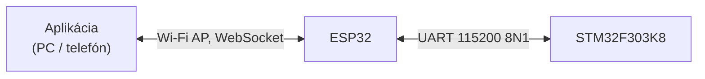
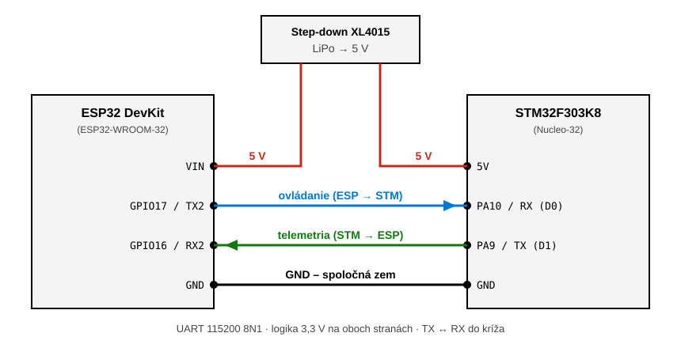
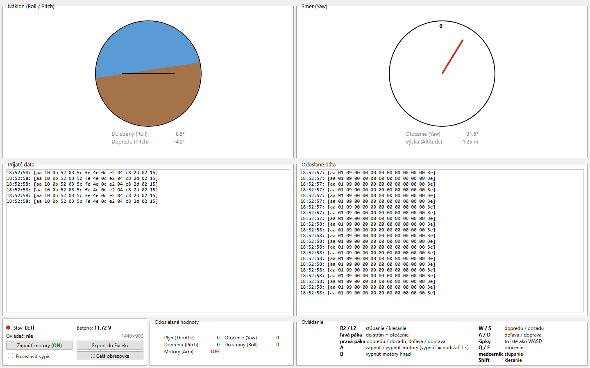
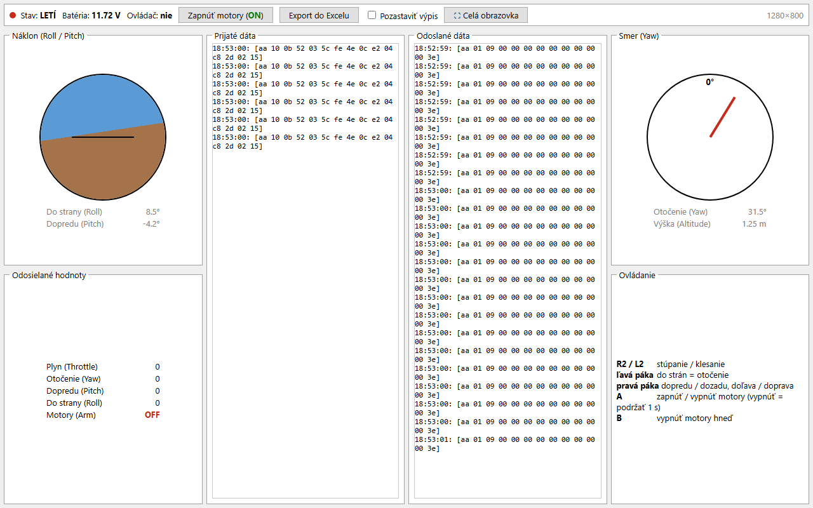
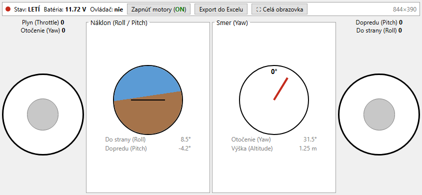

# Komunikácia - Matúš Ondrejka

Bezdrôtové ovládanie dronu a príjem telemetrie medzi aplikáciou (PC, telefón) a STM32F303K8 cez klasické ESP32 (Wi-Fi most).

## Štruktúra
| Priečinok | Obsah |
|---|---|
| [`stm32/`](stm32/) | komunikačný modul pre STM32 (UART, parser, CRC8, telemetria, failsafe) |
| [`esp32-bridge/`](esp32-bridge/) | firmvér ESP32 – Wi-Fi AP + webové UI + WebSocket ↔ UART most |
| [`app/`](app/) | Android aplikácia (Capacitor), APK cez GitHub Actions |

## Architektúra

- ESP32 vytvára vlastnú Wi-Fi sieť (SoftAP `DRON-VRS`), aplikácia sa pripája cez WebSocket.
- ESP32 je transparentný most – rámce iba preposiela, všetka logika beží na STM32.

## Rádiový modul
**Klasické ESP32** (ESP32-WROOM-32 DevKit, napr. ESP32 DevKitC / NodeMCU-32S) – nič špeciálne.

| Parameter | Hodnota |
|---|---|
| MCU | ESP32, 2 jadrá 240 MHz, 2.4 GHz Wi-Fi + Bluetooth |
| UART k STM32 | UART2: GPIO17 (TX2), GPIO16 (RX2) |
| Napájanie | 5 V cez pin VIN (alebo USB pri testovaní) |
| Anténa | PCB anténa na module |
| Dosah | odhad ~30–50 m priama viditeľnosť, ~10–20 m v budove (overiť meraním) |

- Kamera je **zatiaľ vynechaná** – podľa cvičiaceho by bola príliš náročná. Dá sa k nej vrátiť neskôr.

## Zapojenie


| STM32F303K8 | ESP32 | Poznámka |
|---|---|---|
| PA9 – USART1_TX (Nucleo D1) | GPIO16 – RX2 | telemetria STM → ESP |
| PA10 – USART1_RX (Nucleo D0) | GPIO17 – TX2 | ovládanie ESP → STM |
| GND | GND | spoločná zem povinná |
| 5V | VIN | napájanie zo step-down 5 V |

- USART2 (PA2 / PA15) ostáva voľný pre ladiaci výpis cez ST-LINK.
- Logické úrovne 3,3 V na oboch stranách.

## Protokol
Binárny rámec:
```
[0xAA][TYPE][LEN][PAYLOAD (LEN B)][CRC8]
```
| TYPE | Smer | Payload | Frekvencia |
|---|---|---|---|
| `0x01` ovládanie | App → STM | throttle, roll, pitch, yaw (`int16` každý), flags (`uint8`, bit0 = arm) | 50 Hz |
| `0x10` telemetria | STM → App | roll, pitch, yaw (°×100, `int16`), výška (mm, `uint16`), napätie batérie (mV, `uint16`), stav (`uint8`) | 20–50 Hz |
| `0x20` príkaz | App → STM | ID príkazu + parametre (arm/disarm, kalibrácia gyra, PID) | na požiadanie |
| `0x21` ACK | STM → App | ID príkazu + výsledok | odpoveď na `0x20` |

- Little-endian, CRC-8 (polynóm `0x07`, init `0x00`) počítané cez `TYPE`, `LEN` a `PAYLOAD`.
- Osi ovládania v rozsahu `-1000..1000`: throttle `+` = stúpanie, pitch `+` = dopredu, roll `+` = doprava, yaw `+` = doprava; `0` = drž (výšku / polohu).
- Otočenie (yaw) v telemetrii je **relatívne** – `0°` je smer, kam dron mieril pri zapnutí, nie sever. BMI160 má len gyroskop a akcelerometer, magnetometer (kompas) nemá. Na páke je yaw **rýchlosť otáčania**: po pustení sa dron prestane otáčať a drží aktuálny smer.
- Arm sa vykoná iba pri nábežnej hrane bitu arm (0 → 1) a nulovom plyne.
- Rámec s chybným CRC alebo neznámym `TYPE` sa zahodí.
- Ovládanie sa posiela ako **stav** v pravidelnom intervale, nie ako udalosti stlačenia klávesu.
- ESP32 rámce nemení – čo príde cez WebSocket, ide 1:1 na UART a naopak.

## Príkazy – čo sa posiela a čo sa prijíma

### Odosielané (App → ESP32 → STM32)
**`0x01` ovládanie** – 13 B, posiela sa stále 50 Hz.
| Bajt | Pole | Typ | Popis |
|---|---|---|---|
| 0 | štart | `uint8` | `0xAA` |
| 1 | TYPE | `uint8` | `0x01` |
| 2 | LEN | `uint8` | `9` |
| 3–4 | throttle | `int16` | `-1000..1000`, `+` stúpanie, `0` drž výšku |
| 5–6 | roll | `int16` | `-1000..1000`, `+` doprava |
| 7–8 | pitch | `int16` | `-1000..1000`, `+` dopredu |
| 9–10 | yaw | `int16` | `-1000..1000`, `+` doprava |
| 11 | flags | `uint8` | bit0 = arm |
| 12 | CRC8 | `uint8` | cez bajty 1–11 |

Príklady:
```
aa 01 09 00 00 00 00 00 00 00 00 01 39   pokoj, arm=1
aa 01 09 f4 01 00 00 d4 fe 00 00 01 4a   throttle=500, pitch=-300, arm=1
```

**`0x20` príkaz** – na požiadanie (zatiaľ nie je v UI): ID príkazu + parametre (kalibrácia gyra, PID).

### Prijímané (STM32 → ESP32 → App)
**`0x10` telemetria** – 15 B, 20–50 Hz.
| Bajt | Pole | Typ | Popis |
|---|---|---|---|
| 0 | štart | `uint8` | `0xAA` |
| 1 | TYPE | `uint8` | `0x10` |
| 2 | LEN | `uint8` | `11` |
| 3–4 | roll | `int16` | ° × 100 |
| 5–6 | pitch | `int16` | ° × 100 |
| 7–8 | yaw | `int16` | ° × 100, relatívne: `0°` = smer pri zapnutí dronu |
| 9–10 | výška | `uint16` | mm |
| 11–12 | batéria | `uint16` | mV |
| 13 | stav | `uint8` | `0` DISARMED, `1` ARMED, `2` FLYING, `3` LANDING |
| 14 | CRC8 | `uint8` | cez bajty 1–13 |

Príklad:
```
aa 10 0b 96 00 b0 ff 28 23 d2 04 18 2e 02 7e   roll=1.5° pitch=-0.8° yaw=90° výška=1234 mm bat=11800 mV FLYING
```

**`0x21` ACK** – odpoveď na `0x20` (zatiaľ nie je v UI): ID príkazu + výsledok.

Na PC UI zobrazuje odoslané a prijaté rámce (hex + dekódované hodnoty) v dvoch konzolách RX / TX.

## Failsafe
- Ak STM32 nedostane platný ovládací rámec **250 ms**, prechádza do stavu `LANDING`: náklon sa vynuluje a plyn pomaly klesá.
- Po dosadnutí sa dron odzbrojí (`DISARMED`).
- Ak sa spojenie obnoví počas klesania, ovládanie preberá opäť aplikácia.
- Arm je povolený len pri nulovom plyne.

## Ovládanie
**PC / notebook:**
| Kláves | Akcia |
|---|---|
| `W` / `S` alebo `↑` / `↓` | pitch – dopredu / dozadu |
| `A` / `D` alebo `←` / `→` | roll – doľava / doprava |
| `Q` / `E` | yaw – otočenie doľava / doprava |
| `Space` | stúpanie |
| `Shift` | klesanie |

- `Shift` namiesto `Ctrl`, lebo `Ctrl+W` v prehliadači zavrie kartu a nedá sa zablokovať.

**Steam Deck (1280 × 800) a ovládač k PC (Xbox, PlayStation, …):** reálne páky cez Gamepad API (klávesy fungujú tiež).
| Ovládač | Akcia |
|---|---|
| `R2` / `L2` | stúpanie / klesanie (podľa sily stlačenia) |
| ľavá páka doľava / doprava | otočenie (hore / dole nerobí nič) |
| pravá páka | dopredu / dozadu, doľava / doprava |
| `A` | zapnúť / vypnúť motory (prepínač) – zapnutie hneď a iba pri nulovom plyne, vypnutie až po podržaní 1 s, aby ho náhodný stisk za letu nespustil |
| `B` | vypnúť motory hneď |

- Ovládač k PC: USB alebo Bluetooth, prehliadač ho zaregistruje až po prvom stlačení tlačidla (v lište „Ovládač: áno“).
- V Game Mode treba pre prehliadač v Steam Input zvoliť rozloženie ako gamepad, inak páky ovládajú myš.

**Telefón:** dva dotykové joysticky – ľavý: stúpanie / klesanie + yaw, pravý: pitch / roll.

## Webové UI na ESP32
[`esp32-bridge/data/index.html`](esp32-bridge/data/index.html) – jeden súbor (HTML + CSS + JS, bez knižníc a internetu), ESP32 ho servuje na `http://192.168.4.1/`, WebSocket beží na `ws://192.168.4.1:81/`.

Biely vzhľad v štýle MATLAB / tkinter (rámčeky s nadpisom, klasické sivé tlačidlá).

| Zariadenie | Detekcia (rozlíšenie obrazovky) | Rozloženie |
|---|---|---|
| PC | všetko ostatné | hore náklon (roll / pitch) a smer (yaw) s výškou; v strede konzoly – vľavo prijaté (RX), vpravo odoslané (TX); dole ovládanie (tlačidlo zapnúť / vypnúť motory, odosielané hodnoty, klávesy) |
| Steam Deck | presne 1280 × 800 | v strede konzoly RX / TX, vľavo náklon a odosielané hodnoty, vpravo smer a ovládanie; bez joystickov na obrazovke |
| Telefón | kratšia strana < 768 px | joysticky po stranách, nad nimi aktuálne hodnoty, v strede náklon a smer; na výšku výzva otočiť telefón |

- **Celá obrazovka** (tlačidlo v lište, na telefóne aj prvý dotyk mimo tlačidiel) skryje lištu prehliadača a na telefóne zamkne orientáciu na šírku. iPhone to pre webové stránky nepodporuje.
- Rozloženie sa vyberá automaticky; na testovanie sa dá vynútiť cez `?mode=pc|deck|phone` v adrese.
- **Export do Excelu** (tlačidlo v hornej lište, iba pri vypnutých motoroch): súbor `.xlsx` s dvoma hárkami – *Odoslané* (čas, plyn, otočenie, dopredu, do strany, motory, spojenie, rámec v hex) a *Prijaté* (čas, do strany, dopredu, otočenie, výška, batéria, stav, rámec v hex). Zaznamenáva sa od otvorenia stránky, max 100 000 riadkov na hárok.
- Celé UI je po slovensky; stavy dronu: `VYPNUTÝ`, `PRIPRAVENÝ`, `LETÍ`, `PRISTÁVA` (hodnoty 0–3 v telemetrii).
- Konzoly zapisujú pravidelné rámce max 10× za sekundu, udalosti a chyby (spojenie, zmena stavu, chybné CRC, neznámy rámec) vždy; „Pozastaviť výpis“ zastaví posúvanie.
- Odosielanie ovládania 50 Hz, plynulý nábeh hodnôt (0,4 s na plnú hodnotu).
- Pri strate WebSocket spojenia sa automaticky znova pripája a bit arm sa vynuluje.

## Firmvér ESP32 – ako to spustiť
Sketch: [`esp32-bridge/esp32_bridge/esp32_bridge.ino`](esp32-bridge/esp32_bridge/esp32_bridge.ino)

1. **Arduino IDE** → *Boards Manager* → nainštalovať **esp32** (Espressif Systems).
2. *Library Manager* → nainštalovať **WebSockets** (autor Markus Sattler).
3. Otvoriť `esp32_bridge.ino`, doska **ESP32 Dev Module**, nahrať do ESP32.
4. Na PC / telefóne / Steam Decku sa pripojiť na Wi-Fi **`DRON-VRS`**, heslo **`dron1234`**.
5. V prehliadači otvoriť **`http://192.168.4.1/`**.

- **DEMO režim** (`#define DEMO 1`, predvolené): ESP32 si telemetriu vymýšľa samo – náklon reaguje na páky, výška na plyn, po 250 ms bez ovládania „pristáva“. Takto sa dá UI vyskúšať bez STM32.
- Keď je pripojené STM32, nastaviť `#define DEMO 0` – ESP32 potom iba preposiela rámce medzi Wi-Fi a UART2.
- **Modrá LED na ESP32 (GPIO2) bliká**, keď sú motory zapnuté (arm) a spojenie s UI žije; inak nesvieti.
- *Serial Monitor* (115200) vypisuje pripojenie klientov a odoslané rámce.
- Po zmene `data/index.html` treba spustiť `python html_to_header.py` (v priečinku `esp32-bridge`), ktorý UI prevedie do `esp32_bridge/index_html.h`, a firmvér nahrať znova.

## Android aplikácia (APK)
To isté UI zabalené cez Capacitor – celá obrazovka, na šírku a komunikácia cez Wi-Fi `DRON-VRS` aj keď telefón hlási „bez internetu“.
APK zostavuje **GitHub Actions**: *Actions → Android APK → posledný beh → Artifacts → dron-vrs-apk*. Podrobnosti v [`app/README.md`](app/README.md).

## Návrh UI (prvotný mockup)
> Toto je **prvotný mockup** – základ toho, čo chceme robiť. Rozloženie, ovládanie aj vzhľad sa budú ešte meniť.
> Na obrázkoch sú ukážkové dáta.

**PC (1440 × 900)** – hore náklon a smer, v strede konzoly prijatých a odoslaných dát, dole ovládanie.



**Steam Deck (1280 × 800)** – v strede konzoly, po stranách dáta; ovládanie fyzickými pákami.



**Telefón (844 × 390, na šírku)** – v strede náklon a smer, po stranách dotykové joysticky (dá sa ovládať dvoma prstami naraz).



## Úlohy
- [ ] STM32: UART DMA príjem + parser rámcov + CRC8
- [ ] STM32: odosielanie telemetrie
- [ ] STM32: failsafe pri strate spojenia
- [x] ESP32: Wi-Fi AP + webové UI + WebSocket ↔ UART most (základná verzia, DEMO režim)
- [ ] ESP32: otestovať na reálnej doske a so STM32
- [ ] Meranie latencie a stratovosti
- [x] Aplikácia: Android APK (Capacitor) cez GitHub Actions
- [ ] Aplikácia: Electron (PC) – zatiaľ stačí webové UI z ESP32
