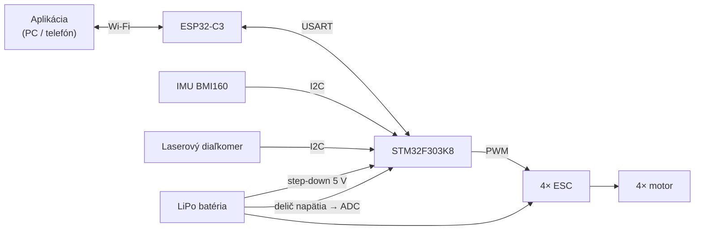
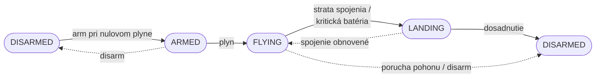

# VRS-drone
 
Semestrálny projekt na predmet VRS, zimný semester 2026/2027.
 
### Zadanie
 
Cieľom je navrhnúť dron, ktorého riadenie zabezpečuje STM32. Stabilizácia dronu bude zabezpečená vďaka gyroskopu a akcelerometru, držanie výšky bude zabezpečené pomocou laserového diaľkomera. Dron bude možné ovládať diaľkovým ovládačom a samotná regulácia bude navrhnutá pomocou PID regulátora. Dáta z telemetrie budú posielané cez Wi-Fi (asi). Stabilizácia sa bude testovať na gimbale.
 
 
## Hardvér
 
| Komponent | ks | Popis |
|---|---|---|
| STM32F303K8 | 1 | Riadiaca doska |
| Rám | 1 | Vytlačený na 3D tlačiarni |
| Vrtule | 4 | Je to proste vrtuľa |
| Motor | 4 | AIR 2216/KV880, požičané od Davida |
| ESC | 4 | AIR 20A, požičané od Davida |
| XL4015 | 1 | Step-down menič napätia na napájanie STM32 (je v škatuli v NCR, možno by sa dal požičať) |
| LiPo batéria + nabíjačka | – | 3S alebo 4S, s dostatočným C |
| DFRobot BMI160 | 1 | Akcelerometer a gyroskop |
| Laserový senzor (Samo, doplň názov) | 1 | Odhad výšky |
| Rádiový modul (ESP32-C3 SuperMini) | 1 | ESP32-C3 bude ako AP pre počítač/telefón/steam deck |
 
## Bloková schéma
 

## Stavy dronu
 

 
| Stav | Čo robia motory |
|---|---|
| `DISARMED` | Stoja, ESC dostáva nulový plyn |
| `ARMED` | Pripravené, čaká sa na plyn |
| `FLYING` | Regulácia beží, riadi aplikácia |
| `LANDING` | Náklon sa vynuluje, plyn pomaly klesá |
 
---
 
## Rozdelenie úloh
 
**Samuel Šubika**
- *Senzorika:* IMU, laserový diaľkomer, sprostredkovanie použiteľných dát na riadenie cez I2C.
- *Modelovanie:* Návrh rámu, výpočet jeho veľkosti, pomer hmotnosti dronu a veľkosti vrtúľ a pod.

**Matúš Ondrejka**
- *Komunikácia:* Ovládanie, rádiový modul, binárny protokol s CRC8, telemetria, failsafe pri strate spojenia, aplikácie pre PC aj telefón.

**Filip Král**
- *Pohon:* Ovládanie motorov pomocou PWM, napájanie (celého dronu), meranie stavu batérie pomocou A/D prevodníka (súčasť STM32). Failsafe: v prípade zlyhania motorov alebo vybitej batérie bezpečné pristátie dronu a vypnutie motorov.

**Jakub Kleman**
- *Regulácia:* Kaskádové PID, mixér motorov, ladenie konštánt.
---
## Otvorené otázky
- Môže byť ESP32-C3 SuperMini?

 
## Stav vypracovania
- [ ] Vypracovanie špecifikácie
- [ ] Objednanie súčiastok
- [ ] Výroba rámu
- [ ] Diaľkové ovládanie
- [ ] Telemetria
- [ ] Test motorov
- [ ] Ovládanie motorov pomocou PWM
- [ ] Driver pre IMU (čítanie a spracovanie dát)
- [ ] Návrh regulátora a test stability na gimbale
- [ ] Ovládanie dronu na gimbale
- [ ] Test letu a držanie výšky
