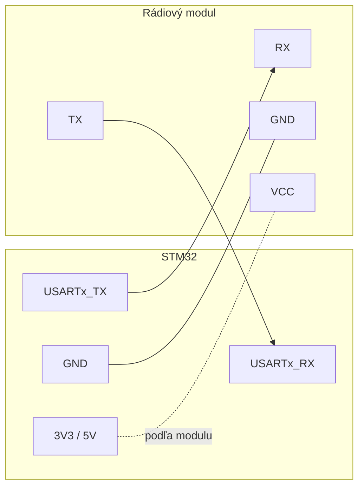

# VRS-drone

Práca so senzorom DFRobot BMI160
Potrebné úlohy:
- Zabezpečiť I2C komunikáciu medzi senzorom a STM32
- Čítanie 6 osí a prepočet hodnôt na stupne
- Kalibrácia gyroskopu
- Odhad náklonu
- Posielanie dát do telemetrie

---

## Komunikácia - Matúš Ondrejka

Bezdrôtové ovládanie dronu a príjem telemetrie medzi riadiacou aplikáciou (PC, telefón) a STM32.

### Hardvér
- Rádiový modul pripojený k STM32 cez UART, správa sa ako transparentná sériová linka.
- Všetka riadiaca logika (parser, failsafe, telemetria) beží na STM32.
- Zapojenie: modul TX → STM32 RX, modul RX → STM32 TX, spoločná zem, 3,3 V logika.
- STM32: UART + DMA príjem s IDLE-line prerušením, kruhový buffer, parser rámcov.

#### Náhľad zapojenia
> Predbežné – konkrétne piny STM32 a typ modulu sa doplnia po rozhodnutí.



| STM32 | Modul | Poznámka |
|---|---|---|
| USARTx_TX (TBD) | RX | dáta STM → modul |
| USARTx_RX (TBD) | TX | dáta modul → STM |
| GND | GND | spoločná zem povinná |
| 3V3 / 5V | VCC | napájacie napätie podľa datasheetu modulu |

- Logické úrovne UART 3,3 V.
- Pred zapojením overiť napájanie a odber modulu z datasheetu.

#### Návrhy rádiového modulu
| Modul | Technológia | Cena | Latencia | PC (Electron) | Telefón (Capacitor) | Poznámka |
|---|---|---|---|---|---|---|
| HM-10 / JDY-23 | BLE 4.x, UART | ~3 € | 15–50 ms | Web Bluetooth | Android + iOS (plugin `@capacitor-community/bluetooth-le`) | max 20 B na zápis |
| HC-05 / HC-06 | Bluetooth Classic (SPP), UART | ~4 € | 20–40 ms | Web Serial (virtuálny COM port) | iba Android, cez plugin | iOS nepodporuje SPP |
| ESP32-C3 SuperMini | WiFi (SoftAP) + WebSocket, UART most | ~3 € | 5–20 ms | WebSocket, bez pluginu | Android + iOS, bez pluginu | vlastný MCU s firmvérom mosta, odber ~100 mA – čaká na schválenie (viď Otvorené otázky) |

### Protokol
Binárny rámec:
```
[0xAA][TYPE][LEN][PAYLOAD (LEN B)][CRC8]
```
| TYPE | Smer | Payload | Frekvencia |
|---|---|---|---|
| `0x01` ovládanie | PC → STM | throttle, roll, pitch, yaw (`int16` každý), flags (`uint8`, bit0 = arm) | 50 Hz |
| `0x10` telemetria | STM → PC | roll, pitch, yaw (°×100, `int16`), napätie batérie (mV, `uint16`), stav (`uint8`) | 20–50 Hz |
| `0x20` príkaz | PC → STM | ID príkazu + parametre (arm/disarm, kalibrácia gyra, PID) | na požiadanie |
| `0x21` ACK | STM → PC | ID príkazu + výsledok | odpoveď na `0x20` |

- Little-endian, CRC8 počítané cez `TYPE`, `LEN` a `PAYLOAD`.
- Rámec s chybným CRC alebo neznámym `TYPE` sa zahodí.
- Ovládanie sa posiela ako **stav** (aktuálne hodnoty v pravidelnom intervale), nie ako udalosti stlačenia klávesu.

### Failsafe
- Ak STM32 nedostane platný ovládací rámec **250 ms**, dron vynuluje náklon (roll / pitch / yaw = 0) a **pomaly klesá** riadeným znižovaním plynu.
- Po dosadnutí (throttle na minime) sa dron odzbrojí (disarm).
- Ak sa spojenie obnoví počas klesania, ovládanie preberá opäť aplikácia.
- Arm je povolený len pri throttle = 0.

### Ovládanie
**Electron (notebook):**
| Kláves | Akcia |
|---|---|
| `W` / `S` alebo `↑` / `↓` | pitch – dopredu / dozadu |
| `A` / `D` alebo `←` / `→` | roll – doľava / doprava |
| `Q` / `E` | yaw – otočenie doľava / doprava |
| `Space` | stúpanie |
| `Ctrl` | klesanie |

- Hodnoty plynulo nabiehajú (rampa), nie skokom.

**Capacitor (telefón):**
- Dva virtuálne joysticky – ľavý: stúpanie / klesanie + yaw, pravý: pitch / roll.

**Spoločné:**
- Zdieľaný kód pre protokol a ovládací stav, rozdielna len vrstva vstupu a transportu.
- Zobrazenie telemetrie: náklon, napätie, stav spojenia (strata paketov, latencia).

### Otvorené otázky
- [ ] Môže byť ESP32-C3 SuperMini?

### Úlohy
- [ ] Výber rádiového modulu
- [ ] STM32: UART DMA príjem + parser rámcov + CRC8
- [ ] STM32: odosielanie telemetrie (napojenie na dáta z BMI160)
- [ ] STM32: failsafe – pomalé klesanie pri strate spojenia
- [ ] Zdieľaná knižnica protokolu (TypeScript)
- [ ] Electron aplikácia – pripojenie, ovládanie klávesnicou
- [ ] Capacitor aplikácia – pripojenie, joystick UI
- [ ] Meranie latencie a stratovosti
