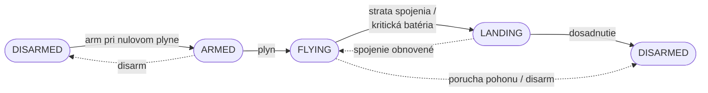

# VRS-drone

Projekt je postavený na dronovej platforme **Airvolute**. Dron drží rovinu vďaka kaskádovej PID regulácii, počúva povely z notebooku alebo telefónu a posiela späť telemetriu. Keď sa niečo pokazí (spojenie, batéria, motor), vie sám bezpečne pristáť.

---

## Stavy dronu

| Stav | Čo robia motory |
|---|---|
| `DISARMED` | stoja, ESC dostáva nulový plyn |
| `ARMED` | pripravené, čaká sa na plyn |
| `FLYING` | regulácia beží, riadi aplikácia |
| `LANDING` | náklon sa vynuluje, plyn pomaly klesá |

---

## Kto čo robí

**Samuel Šubika – Senzorika**
 BMI160 cez I2C, kalibrácia gyroskopu, odhad náklonu, výška z GPS.

**Matúš Ondrejka – Komunikácia**
Ovladanie. Rádiový modul, binárny protokol s CRC8, telemetria, failsafe pri strate spojenia, aplikácie pre PC aj telefón.

**Filip Král – Pohon**
Pohon motorov a citanie baterie. ESC cez PWM / DShot, armovanie, meranie napätia cez ADC, failsafe pohonu.

**Jakub Kleman – Regulácia**
Kaskádové PID, mixér motorov, ladenie konštánt.

### Kto komu čo odovzdáva

| Od | Komu | Čo |
|---|---|---|
| Senzorika | Regulácia | uhly roll / pitch / yaw, uhlové rýchlosti |
| Senzorika | Komunikácia | dáta pre telemetriu |
| Komunikácia | Regulácia | žiadaný plyn, roll, pitch, yaw, arm / disarm, PID konštanty |
| Regulácia | Pohon | plyn pre 4 motory |
| Pohon | Regulácia | failsafe flagy (batéria, porucha pohonu) |
| Pohon | Komunikácia | napätie batérie, stav |

---

## Hardvér

| Podsystém | Súčiastka | Pripojenie |
|---|---|---|
| Mozog | STM32F303K8 (NUCLEO) alebo riadiaca doska integrovaná v drone Airvolute – typ zatiaľ nie je známy | – |
| Rám a pohon | dron Airvolute – rám, motory, vrtule | – |
| Pohon | ESC (integrované na doske Airvolute alebo vlastné 4-in-1) | PWM / DShot |
| Pohon | LiPo batéria 6S + odporový delič napätia | ADC |
| Senzorika | DFRobot BMI160 | I2C |
| Senzorika | GPS modul | UART |
| Komunikácia | rádiový modul (HM-10 / HC-05 / ESP32-C3 SuperMini) | UART |

#### Failsafe
| Situácia | Detekcia | Reakcia |
|---|---|---|
| Strata signálu medzi STM32 a ESC (výpadok kábla, zaseknutý program) | ESC samo deteguje chýbajúci signál; v STM32 watchdog (IWDG) | ESC po timeoute samo zastaví motory, STM32 sa po zaseknutí reštartuje |
| Porucha motora / ESC | pri bidirectional DShot: motor nevracia otáčky pri nenulovom plyne | vyslanie flagu chyby pohonu, vypnutie motorov (kvadrokoptéra nedokáže letieť na 3 motoroch) |
| Chyba pri čítaní batérie | hodnota mimo reálneho rozsahu alebo ADC/I2C neodpovedá | rovnako ako pri kritickej úrovni – vyslanie flagu na okamžité pristátie |
| Nízka batéria – varovanie | napätie pod hranicou varovania | vyslanie varovného flagu (návrat / pristátie podľa rozhodnutia riadiacej časti) |
| Nízka batéria – kritická | napätie pod kritickou hranicou | vyslanie flagu, ktorý prikáže okamžité pristátie drona a následné vypnutie motorov |
| Strata príkazov z riadiacej časti | žiadny nový príkaz počas stanoveného času | pristátie, prípadne vypnutie motorov |

#### Otvorené otázky
- Môže byť ESP32-C3 SuperMini?
---

